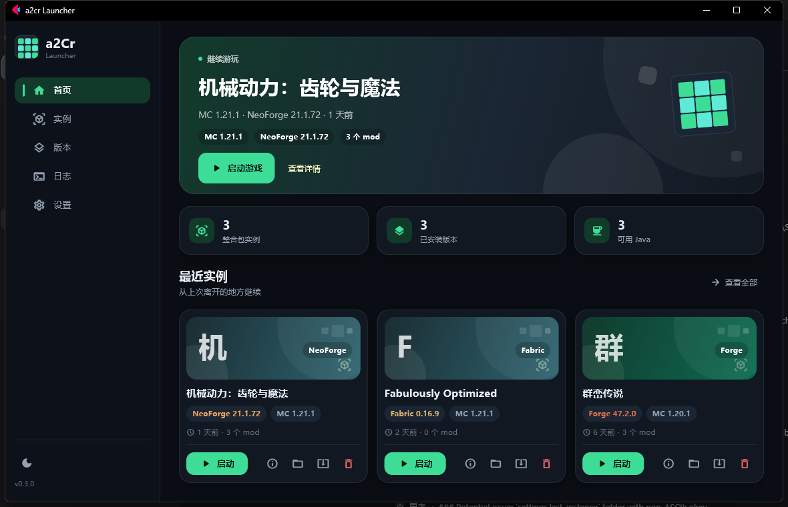

# a2Cr Launcher

**A Minecraft launcher optimized for juggling many versions at once.**

It is not about "install it and it runs" — the existing launchers already do that. It is about the friction of switching between versions, loaders and modpacks.

A personal learning project: written once in Python, being rewritten in C#.

> **Status (2026-11)**
> - **v1 (Python + Flet) is frozen** — tag `v1-final`, archived under [`legacy/v1-python/`](legacy/v1-python/README.md). Bug fixes only.
> - **v2 (C# + Avalonia) is at the design stage** — contracts are written, no code yet. See [`docs/contracts/`](docs/contracts/00-索引.md).
> - All screenshots below are v1.



## Why two languages

v1 shipped as 132 MB / 1900 files with Flet (including 33 MB of development tooling that should never have been bundled). A C# + Avalonia build is expected around 35–55 MB as a single file.

The bigger reason is learning: the point of this project is to build the same launcher twice, in two stacks.

## What it tries to solve

1. **Isolate mods only, share everything else.** Existing launchers offer "isolate the whole game directory or share all of it". What players actually want is per-category granularity: isolate `mods`, share resource packs, shaders and video settings.
2. **Sandbox / clone a version.** Drop a few mods in for a session with friends, disable them again for singleplayer.
3. **Move mods across versions.** Your pack is on 26.2, your friend's server is on 1.21.

Read [`docs/产品想法.md`](docs/产品想法.md) (Chinese) for the full rationale.

## Documentation

| Document | Contents |
|---|---|
| [Product ideas](docs/产品想法.md) | Why it exists, the three requirements, the four-layer model |
| [Contracts](docs/contracts/00-索引.md) | v2 interfaces and on-disk layout — **read before writing code** |
| [Getting started](docs/guides/00-Intro.md) | Environment setup, how to phrase a task |
| [Learning notes](docs/learning/README.md) | Avalonia launch path, C# vocabulary, how to find answers |
| [Docs map](docs/README.md) | Start here if you don't know which file to read |

## Repository layout

```text
docs/                 ← ideas / contracts / guides / learning notes
legacy/v1-python/     ← the whole v1 code base, frozen, kept as a reference implementation
build/                ← build output, not tracked
```

Once v2 starts, `src/` (`a2Cr.Core`, `a2Cr.Cli`, `a2Cr.app`) and `tests/` will appear.

## Running v1

```powershell
cd legacy/v1-python
uv sync
uv run al-gui
uv run python -m tests.smoke
```

## Contributing

See [CONTRIBUTING.md](CONTRIBUTING.md). In short: v1 takes bug fixes only, new features go into v2 per the contracts.

## License

[MIT](LICENSE.md)
