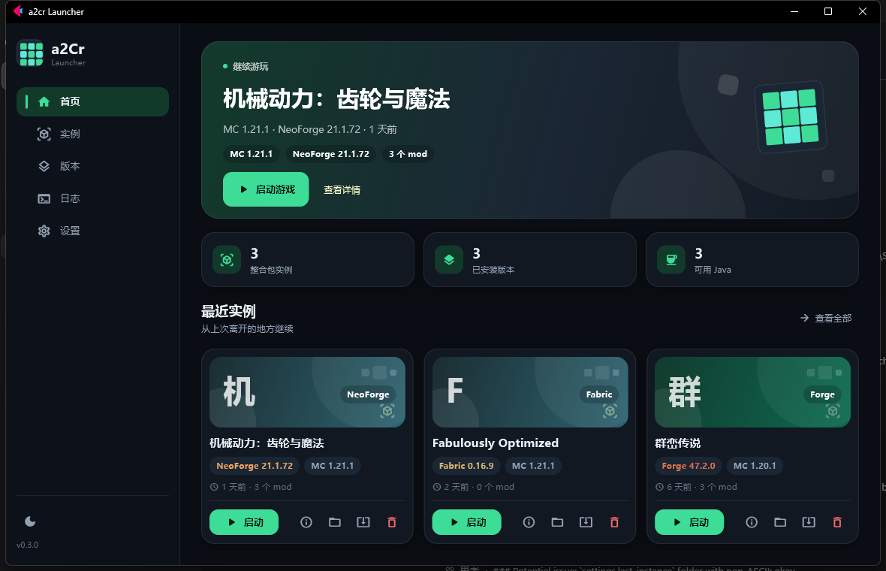
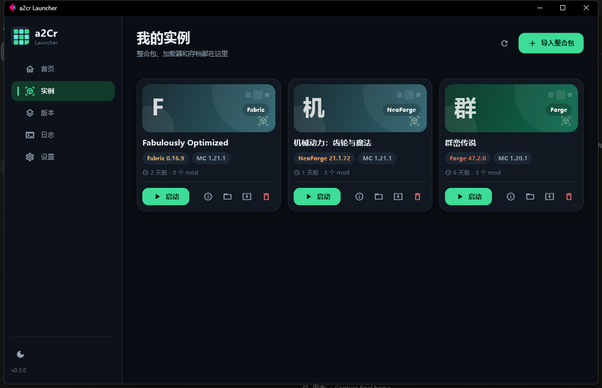
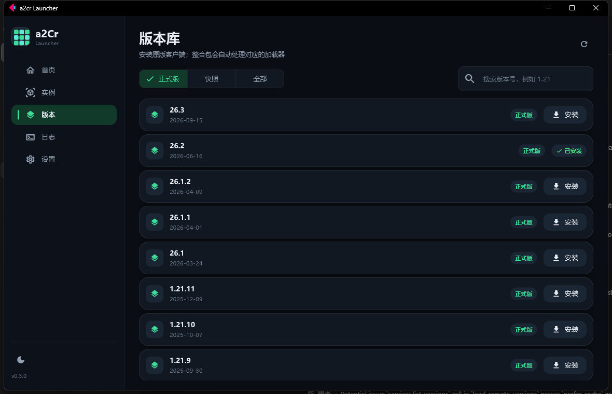
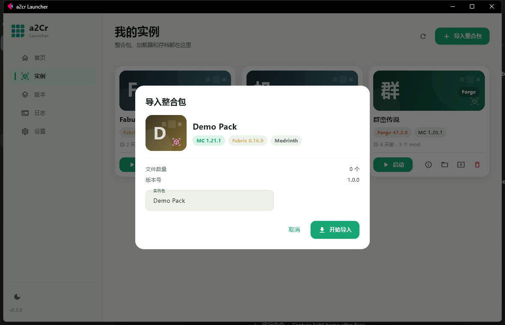
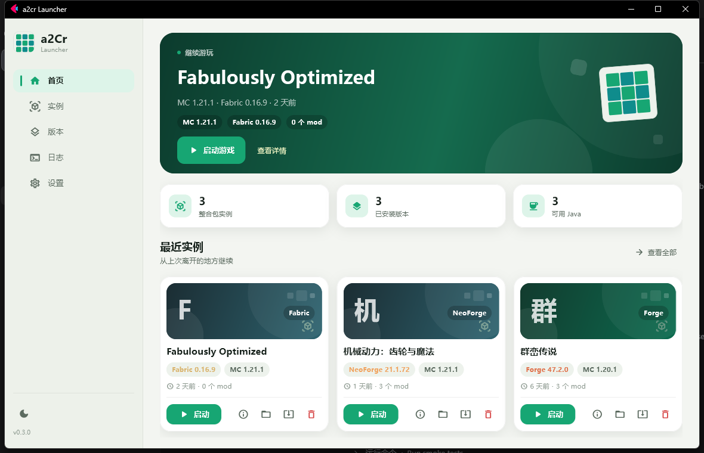

# a2Cr Launcher

**一个尝试为多版本而优化的、自用的、学习用的 Minecraft 启动器。**
> [!Warning]
> a2Cr Launcher 只作为个人的 **学习项目**，它和 Microsoft、Mojang Studios 和 Modrinth、CurseForge等等第三方平台 **没有**
任何联系。

> **当前状态（2026-11）**
> - **v1（Python + Flet）已冻结**，最后一个版本是 tag `v1-final`，代码归档在 [
    `legacy/v1-python/`](legacy/v1-python/README.md)，只修致命 bug。
> - **v2（C# + Avalonia）在设计阶段**，契约已定，代码还没开始写，见 [`docs/contracts/`](docs/contracts/00-索引.md)。
> - 下面的截图全部是 v1 的界面。

> **项目状态（2026-11）**
> v1（Python + Flet）已冻结，最后一个版本对应 tag `v1-final`，之后只修 bug。
> 下一代 v2 正在用 C# / Avalonia 重写，设计契约见
> [`docs/a2Cr Launcher 2 Contracts/`](docs/a2Cr%20Launcher%202%20Contracts/00-索引.md)。
> 下面的内容描述的是 v1 的用法。

> **项目状态（2026-11）**
> v1（Python + Flet）已冻结，最后一个版本对应 tag `v1-final`，之后只修 bug。
> 下一代 v2 正在用 C# / Avalonia 重写，设计契约见
> [`docs/a2Cr Launcher 2 Contracts/`](docs/a2Cr%20Launcher%202%20Contracts/00-索引.md)。
> 下面的内容描述的是 v1 的用法。



## 界面预览（v1）

| 实例                                    | 版本                                   |
|-----------------------------------------|----------------------------------------|
|  |  |

| 导入                                       | 浅色主题                                 |
|--------------------------------------------|------------------------------------------|
|  |  |

## 为什么用两种语言

v1 用 Python + Flet 写的，能正常启动游戏，但打包出来 132 MB、1900 多个文件，还打包了 33 MB 开发工具。换成 C# + Avalonia 预期能压到
35–55 MB 的单文件。

更重要的原因是 **学习**：这个项目的目的就是在两种技术栈里各写一遍启动器。

## 这个启动器想解决什么

1. **只隔离 mod，别的都共享** —— 现有启动器的版本隔离是"整份隔离或全共享"的二选一，但真实需求是按类别决定粒度：`mods`
   要隔离，材质包、光影、画面设置要共享。
2. **沙盒化 / 复制一个版本** —— 临时加几个 mod 和朋友联机，自己玩时再关掉。
3. **mod 跨版本** —— 整合包是 26.2、朋友的服务器是 1.21，不想重装一遍。

完整想法见 [`docs/产品想法.md`](docs/产品想法.md)。

## 文档

| 文档                                  | 内容                                       |
|---------------------------------------|--------------------------------------------|
| [产品想法](docs/产品想法.md)          | 为什么做、三条需求、四层数据模型           |
| [契约索引](docs/contracts/00-索引.md) | v2 的接口与磁盘布局，**改代码前先读这里**  |
| [新人上手](docs/guides/00-Intro.md)   | 环境配置、任务怎么写                       |
| [学习笔记](docs/learning/README.md)   | Avalonia 启动链路、C# 词表、怎么自己找答案 |
| [文档地图](docs/README.md)            | 不知道看哪份时，从这里进                   |

## 仓库结构

```text
docs/                 ← 文档（产品想法 / 契约 / 上手 / 学习笔记）
legacy/v1-python/     ← v1 全部代码，已冻结，保留作参考实现
build/                ← 构建产物，不入库
```

v2 开工后会新增 `src/`（`a2Cr.Core` / `a2Cr.Cli` / `a2Cr.app`）和 `tests/`。

## 跑一下 v1（已归档）

v1 能真实启动游戏，做参考实现很有用：

```powershell
cd legacy/v1-python
uv sync
uv run al-gui                  # 图形界面
uv run python -m tests.smoke   # 离线冒烟测试
```

想让它不碰真实的 `~/.a2CrLauncher`：

```powershell
$env:A2CR_ROOT = "$PWD\artifacts\demo-root"
uv run al-gui
```

## 许可和参与项目开发


a2Cr Launcher 欢迎各位对它来添砖加瓦。  
如果遇到 Bug 或者有一些新的 Feature，欢迎提交 [Issues](https://github.com/CILXRY/a2Cr-Launcher/issues/new/choose)。  
想要参与项目开发见 [CONTRIBUTING.md](CONTRIBUTING.md)，那里有比较详细的文档。

end. minecraft launcher by CILXRY.
