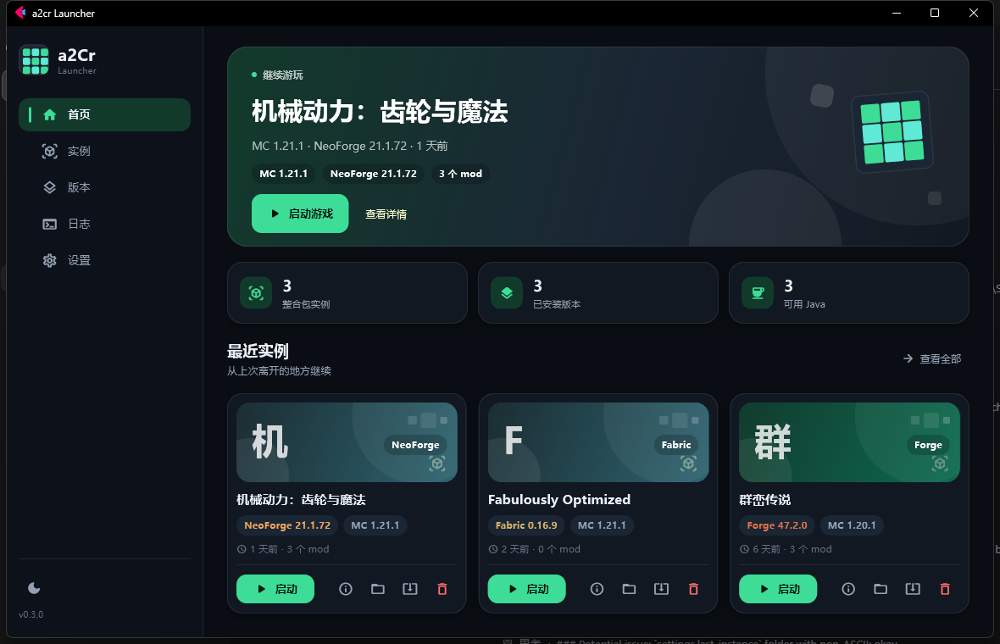
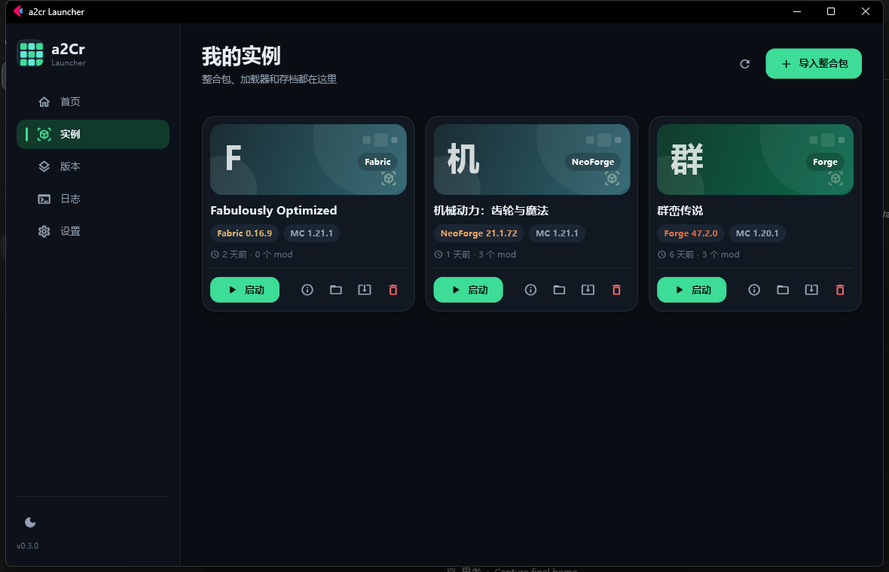
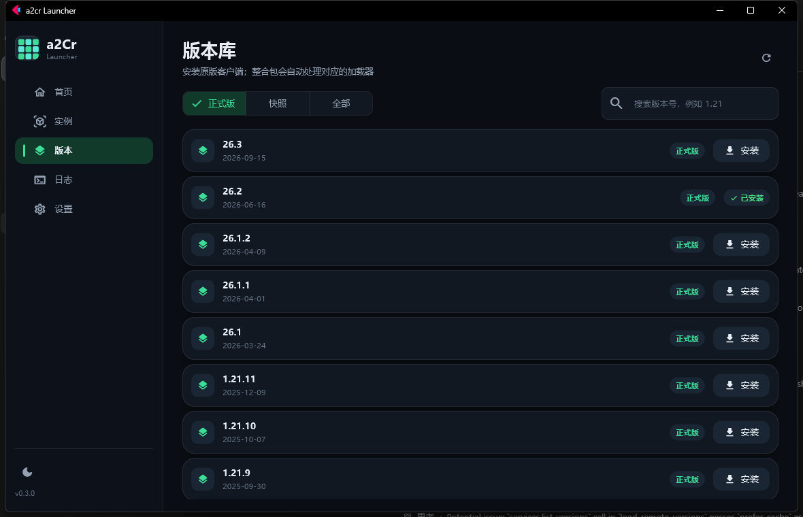
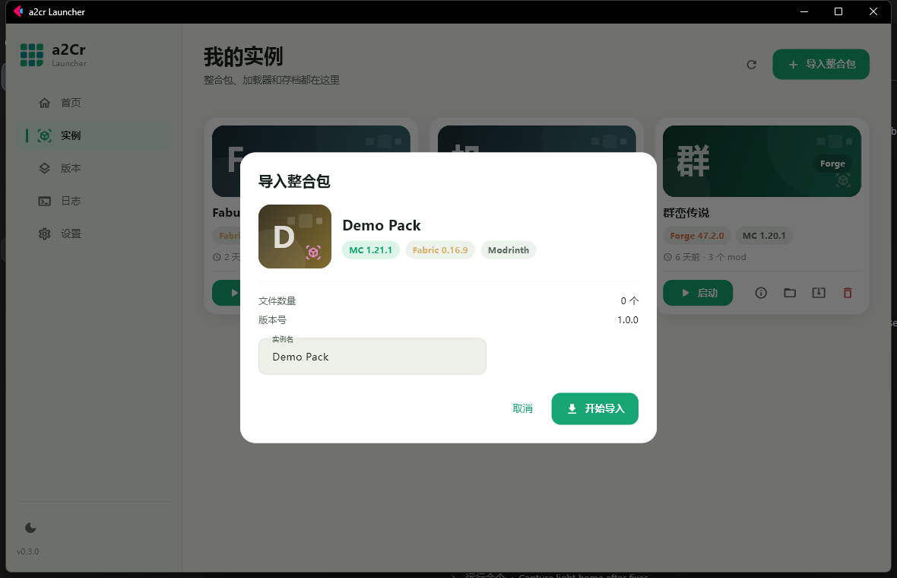
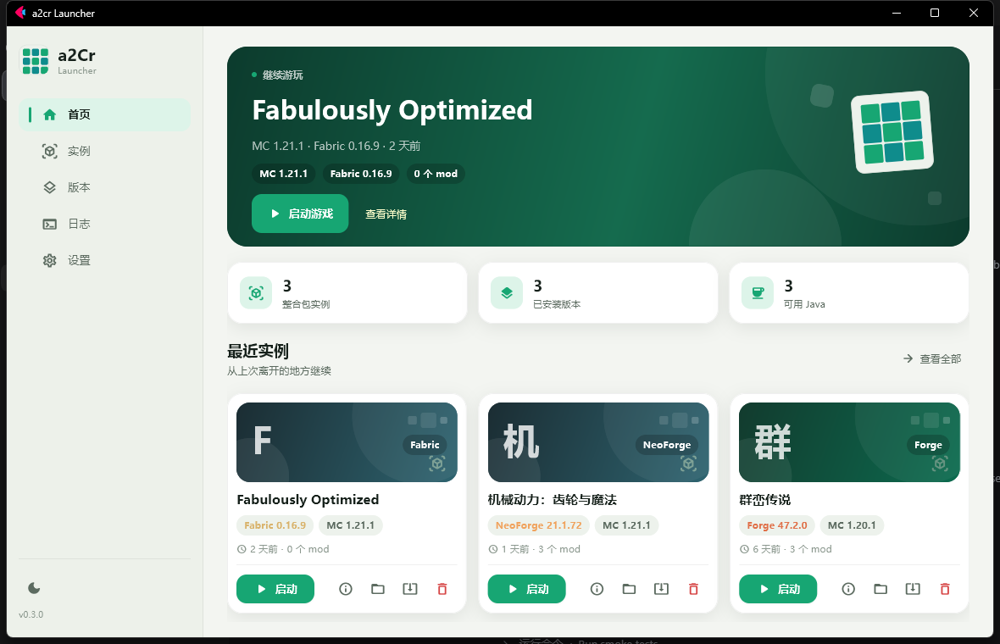

# a2Cr Launcher

> **这是归档的 v1 代码（Python + Flet），已冻结。**
> 新的开发方向是 v2（C# + Avalonia），契约见
> [`docs/contracts/`](../../docs/contracts/00-索引.md)。
> 下面保留的是 v1 当时的说明，命令需要在 `legacy/v1-python/` 目录里执行。

一个使用 Python 制作的 Minecraft 启动器（CLI + 图形界面）

> **项目状态（2026-11）**
> v1（Python + Flet）已冻结，最后一个版本对应 tag `v1-final`，之后只修 bug。
> 下一代 v2 正在用 C# / Avalonia 重写，设计契约见
> [`../../docs/contracts/`](../../docs/contracts/00-索引.md)。
> 下面的内容描述的是 v1 的用法。



## 界面预览

| 实例 | 版本 |
|---|---|
|  |  |

| 导入 | 浅色主题 |
|---|---|
|  |  |


## 如何开发


## 使用

### 图形界面

```bash
uv run al-gui
```

图形界面提供：

- 首页继续游玩、实例卡片和运行状态
- 导入 / 更新 Modrinth、CurseForge、HMCL / PCL 整合包
- 启动、停止游戏，实时查看整合包和游戏日志
- 浏览 Mojang 版本列表并安装原版
- 设置玩家名、最大内存、Java 运行时和主题
- 删除实例时先移入启动器回收站（`~/.a2CrLauncher/.trash`）

如果在开发时需要把启动器数据放到别的目录（例如做界面截图、避免动真实实例）：

```powershell
$env:A2CR_ROOT = "$PWD\artifacts\demo-root"
uv run al-gui
```

### 命令行

```bash
uv run al version                         # 查看可用版本
uv run al install --version 26.2          # 安装原版
uv run al launch --version 26.2           # 启动原版
```

### 正版登录（微软账号）

```bash
uv run al login      # 按提示打开 https://www.microsoft.com/link 输入代码
uv run al account    # 查看当前账号、令牌过期时间
uv run al logout     # 退出当前账号
```

登录使用微软的**设备代码流程**，不需要密码、不需要开浏览器回调。登录后启动游戏会自动带上正版账号：

```bash
uv run al launch --instance "机械动力"          # 有登录时自动用正版账号
uv run al launch --instance "机械动力" --offline # 强制离线
uv run al launch --version 26.2 --offline --username Steve  # 离线模式自定义名字
```

账号信息（含 refresh token）保存在 `~/.a2CrLauncher/auth.json`，access token 快过期时会自动续期；换机器或想退出时运行 `al logout` 删除即可。

### 导入整合包

支持三种整合包格式：

- **Modrinth** `.mrpack`
- **CurseForge** 整合包 `.zip`（压缩包里有 `manifest.json`）
- **HMCL / PCL** 导出的整合包（压缩包里有 `.minecraft` 目录）

```bash
uv run al import "Fabulously Optimized.mrpack"
uv run al import "Create 整合包.zip" --name "机械动力"
```

导入时会自动完成：

1. 识别 Minecraft 版本和加载器（Fabric / Quilt / Forge / NeoForge）
2. 下载原版客户端、资源文件和运行库
3. 安装对应加载器（Forge / NeoForge 会调用官方安装器，第一次会慢一些）
4. 解压 `overrides` 或整合包自带的文件到 `~/.a2CrLauncher/instances/<实例名>/`
5. 下载清单里的 mods

导入完成后启动：

```bash
uv run al launch --instance "机械动力"
uv run al launch --instance "机械动力" --memory 8G   # 大型整合包可以调大内存
```

查看已经导入的整合包：

```bash
uv run al instance list
```

### 下载模组

从 [Modrinth](https://modrinth.com/mods) 搜索模组，直接装进指定实例（自动适配实例的 Minecraft 版本和加载器，并补上前置依赖）：

```bash
# 在实例的版本/加载器范围内搜索
uv run al mod search jei --instance "机械动力"

# 安装（自动选最新兼容版本，自动下载 required 依赖）
uv run al mod install jei --instance "机械动力"

# 只看某个版本、不装依赖
uv run al mod install jei --instance "机械动力" --version-id <Modrinth 版本 id> --no-deps

# 查看实例里已经装了哪些模组
uv run al mod list --instance "机械动力"
```

没有实例时也可以按版本和加载器搜索：

```bash
uv run al mod search sodium --version 1.21.1 --loader fabric
```

